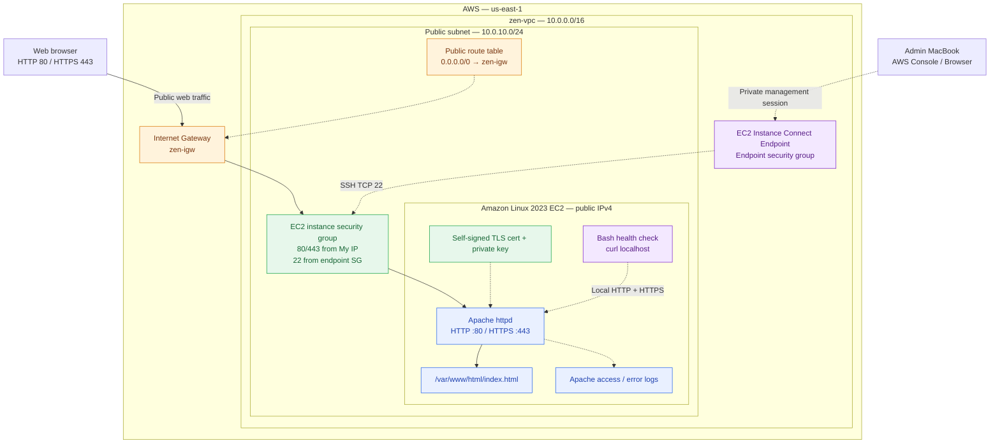

# AWS EC2 Apache HTTP/HTTPS Web Server — Linux System Administration Lab


## 1. Project Overview

This hands-on lab documents how to deploy, configure, secure, test, and troubleshoot an **Apache HTTP Server (`httpd`)** running on an **Amazon Linux 2023 EC2 instance** in an existing AWS VPC.

The lab covers both **HTTP (TCP/80)** and **HTTPS (TCP/443)** using a **self-signed TLS certificate**, with separate access paths for:

- **Server administration:** AWS EC2 Instance Connect Endpoint over SSH (TCP/22).
- **Web traffic:** A browser connecting to the EC2 instance's public IPv4 address through an Internet Gateway, when public access is enabled.
- **Local verification:** `curl` commands and a Bash health-check script run inside the EC2 instance.

The project also demonstrates Apache service management using `systemctl`, TLS configuration, Linux file permissions, log analysis, and failure/recovery testing.

> **Lab scope:** This is a learning environment, not a production deployment. A self-signed certificate encrypts traffic but is not trusted by browsers by default. The certificate generated below is valid for `localhost`, not the instance's public IPv4 address. Validation commands and screenshot slots are provided; upload evidence after completing each test.

---

## 2. Learning Objectives

- Reuse existing AWS VPC networking instead of creating new infrastructure unnecessarily.
- Install and update packages with the Amazon Linux `dnf` package manager.
- Manage Apache with `systemctl` and configure it to start on boot.
- Publish a custom static HTML page under `/var/www/html/`.
- Install the Apache SSL module (`mod_ssl`) and create a self-signed TLS certificate using OpenSSL.
- Configure the Apache HTTPS virtual host and validate configuration syntax.
- Test HTTP/HTTPS responses and inspect listening TCP ports.
- Restrict network access with AWS security groups.
- Access the EC2 instance privately using an EC2 Instance Connect Endpoint.
- Review Apache and systemd logs and run a Bash health-check script.
- Document deployment, testing, troubleshooting, and cleanup in GitHub.

---

## 3. AWS Environment and Existing Infrastructure

This project builds on the AWS networking infrastructure used in previous labs.

| Component | Configuration / Role |
| --- | --- |
| AWS Region | `us-east-1` (N. Virginia) |
| VPC | `zen-vpc` — `10.0.0.0/16` |
| Public subnet | `zen-public` — `10.0.10.0/24` |
| Public route table | `zen-public route-table` — `0.0.0.0/0` routed to `zen-igw` |
| Internet Gateway | `zen-igw` — public internet route for the public subnet |
| EC2 instance | Amazon Linux 2023; public-subnet instance running Apache |
| EC2 instance security group | `zen-public-sg` — HTTP/HTTPS and authorized SSH access |
| EC2 Instance Connect Endpoint SG | `zen-instance-connect-endpoint-sg` — administrative connection path |
| Instance management | EC2 Instance Connect Endpoint / SSH on TCP port `22` |
| Web protocols | HTTP `80` and HTTPS `443` |
| Web document root | `/var/www/html/` |
| Apache package/service | `httpd` |
| TLS configuration file | `/etc/httpd/conf.d/ssl.conf` |

**Networking notes:**

1. A subnet with a default route to an Internet Gateway is a *public subnet*, but an EC2 instance also needs a **public IPv4 address** (or a suitable public IP configuration) to be reached over IPv4 from the internet.
2. A security group alone does **not** provide an internet route.
3. An **EC2 Instance Connect Endpoint** provides a private management connection; it does **not** function as a NAT Gateway or supply internet access for `dnf` package installations.
4. Outbound package installation also requires working DNS resolution and an applicable route/security configuration.
5. The Instance Connect Endpoint can be in a different subnet. Its exact placement is not essential to this web-server lab.

### Architecture Diagram



**Traffic flows:**

- **Browser → HTTP/HTTPS:** MacBook/browser → Internet Gateway → EC2 security group → Apache `:80` or `:443`.
- **Administrator → SSH:** AWS Console/management client → EC2 Instance Connect Endpoint → EC2 private IP on TCP `22`.
- **Health checks:** Script running on EC2 → `http://localhost` and `https://localhost` → Apache.


---

## 4. Security Group and Connectivity Configuration

For browser testing from a known network, restrict web access to the administrator's **current public IPv4 address** instead of exposing it globally.

**EC2 instance security group: `zen-public-sg`**

| Rule | Protocol | Port | Source | Purpose |
| --- | --- | --- | --- | --- |
| HTTP | TCP | `80` | `MY_PUBLIC_IP/32` | Browser HTTP tests |
| HTTPS | TCP | `443` | `MY_PUBLIC_IP/32` | Browser HTTPS tests |
| SSH | TCP | `22` | EC2 Instance Connect Endpoint SG | Endpoint-based administrative access |

For the **Instance Connect Endpoint security group**, allow **outbound TCP/22 to the EC2 instance security group**. With standard source-IP behavior, the EC2 instance's inbound SSH rule can reference the endpoint's security group. If *client IP preservation* is enabled, the allowed source needs to match the original client address instead. Consult the actual endpoint settings.

**AWS Console checks:**

1. Go to **EC2 → Instances** and select the Apache instance.
2. Verify its subnet is `zen-public` and the VPC is `zen-vpc`.
3. Verify a **public IPv4 address** is assigned for public-browser tests.
4. Under **Security**, open `zen-public-sg` and verify TCP/80, TCP/443, and SSH rules.
5. Under **VPC → Route tables**, verify the public subnet uses a route table with `0.0.0.0/0 → zen-igw`.
6. Continue using the **EC2 Instance Connect Endpoint** for SSH administration, without exposing SSH publicly.


---

## 5. Connect to EC2 and Confirm the Operating System

Use **EC2 → Instances → Connect → EC2 Instance Connect** with the existing Instance Connect Endpoint connection option.

In the EC2 terminal:

```bash
whoami
hostname
cat /etc/os-release
```

Confirm that the host uses **Amazon Linux 2023** before following the package commands below.

### Update the instance

```bash
sudo dnf update -y
```

> `dnf` needs a working route to repositories. If the command fails with a network/repository error, first troubleshoot DNS, routing, public IP, outbound security rules, and any relevant network ACLs. An Instance Connect Endpoint does not provide outbound internet access.

---

## 6. Install and Start Apache HTTP Server

### Install the package

```bash
sudo dnf install httpd -y
httpd -v
```

### Start Apache and enable automatic boot startup

```bash
sudo systemctl start httpd
sudo systemctl enable httpd
```

### Verify service status

```bash
sudo systemctl status httpd
systemctl is-active httpd
systemctl is-enabled httpd
```

**Expected:** `active (running)`, `active`, and `enabled`.

Useful service management commands:

| Command | Purpose |
| --- | --- |
| `sudo systemctl start httpd` | Start Apache |
| `sudo systemctl stop httpd` | Stop Apache |
| `sudo systemctl restart httpd` | Restart Apache |
| `sudo systemctl reload httpd` | Reload configuration |
| `sudo systemctl status httpd` | View service state |
| `sudo systemctl enable httpd` | Start at boot |


---

## 7. Publish a Custom HTML Test Page

The default Apache document root is `/var/www/html/`.

```bash
sudo nano /var/www/html/index.html
```

Add the following content:

```html
<!DOCTYPE html>
<html lang="en">
<head>
    <meta charset="UTF-8">
    <title>Zen Apache Server Lab</title>
</head>
<body>
    <h1>Apache Web Server Running!</h1>
    <h2>Mind of Zen - Linux Administration Lab</h2>

    <p>Server: Amazon Linux EC2</p>
    <p>Web Server: Apache HTTP Server</p>
    <p>Status: Online</p>

    <hr>
    <p>Deployed and configured on AWS EC2.</p>
</body>
</html>
```

Save using **Ctrl+O**, **Enter**, then **Ctrl+X**.

Check that the file exists:

```bash
ls -l /var/www/html/index.html
cat /var/www/html/index.html
```

> The `Status: Online` message is static HTML; the Bash script later in this README performs a real health check.

### Test HTTP locally

```bash
curl http://localhost
curl -I http://localhost
```

**Expected:** The HTML document and an HTTP status line similar to `HTTP/1.1 200 OK`.


---

## 8. Enable HTTPS with a Self-Signed TLS Certificate

### Install TLS components

```bash
sudo dnf install mod_ssl openssl -y
```

### Create the certificate and private key

```bash
sudo openssl req -x509 -nodes -days 30 \
  -newkey rsa:2048 \
  -keyout /etc/pki/tls/private/zen-apache.key \
  -out /etc/pki/tls/certs/zen-apache.crt \
  -subj "/CN=localhost" \
  -addext "subjectAltName=DNS:localhost,IP:127.0.0.1"
```

**Files created:**

| File | Purpose |
| --- | --- |
| `/etc/pki/tls/certs/zen-apache.crt` | Public TLS certificate |
| `/etc/pki/tls/private/zen-apache.key` | Sensitive private key; **never commit to GitHub** |

Limit access to the private key:

```bash
sudo chmod 600 /etc/pki/tls/private/zen-apache.key
```

### Configure the SSL virtual host

Open the Apache SSL configuration file:

```bash
sudo nano /etc/httpd/conf.d/ssl.conf
```

Inside the HTTPS virtual host, ensure `SSLEngine on` is active and **replace** the existing certificate/key directives with:

```apache
SSLEngine on
SSLCertificateFile /etc/pki/tls/certs/zen-apache.crt
SSLCertificateKeyFile /etc/pki/tls/private/zen-apache.key
```

Do **not** add duplicate active `SSLCertificateFile` or `SSLCertificateKeyFile` directives.

### Validate configuration and restart Apache

```bash
sudo httpd -t
sudo systemctl restart httpd
sudo systemctl status httpd
```

**Expected:** `Syntax OK` followed by `active (running)`.

> **TLS note:** This certificate is self-signed and identifies `localhost` / `127.0.0.1`. Testing `https://PUBLIC_IP` will cause both a trust warning and a hostname mismatch. Do not use this certificate as-is for a production website. For a real public domain, obtain a trusted certificate that matches that hostname.


---

## 9. Verify HTTP and HTTPS Connectivity

### Test HTTP locally

```bash
curl -I http://localhost
```

### Test HTTPS locally

```bash
curl -k https://localhost
curl -kI https://localhost
```

`-k` bypasses certificate validation **for this controlled self-signed lab test only**. For production checks, do not suppress certificate verification.

**Expected responses:**

| Test | Expected result |
| --- | --- |
| `curl -I http://localhost` | HTTP `200 OK` |
| `curl -kI https://localhost` | HTTPS `200 OK` |
| `sudo httpd -t` | `Syntax OK` |
| `systemctl is-active httpd` | `active` |

### Inspect listening TCP ports

```bash
sudo ss -ltnp | grep -E ':80|:443'
```

**Expected:** Apache listening on ports `80` and `443`.

### Browser test (only when public IPv4 is configured)

Using the instance's actual **public IPv4 address**:

```text
http://YOUR_PUBLIC_IPV4
https://YOUR_PUBLIC_IPV4
```

A browser will warn about the self-signed, `localhost`-only TLS certificate. This is expected. Browser reachability depends on the public IP, route table, security group, and network rules being correct; it is **not** provided by EC2 Instance Connect Endpoint.


---

## 10. Monitor Apache Logs and Service State

View recent HTTP requests:

```bash
sudo tail -n 20 /var/log/httpd/access_log
```

View recent Apache errors:

```bash
sudo tail -n 20 /var/log/httpd/error_log
```

Watch the HTTP access log in real time:

```bash
sudo tail -f /var/log/httpd/access_log
```

Use **Ctrl+C** to leave follow mode.

Inspect HTTPS access logs if present:

```bash
sudo tail -n 20 /var/log/httpd/ssl_access_log
```

Inspect `httpd` systemd journal messages:

```bash
sudo journalctl -u httpd -n 30 --no-pager
```

> Actual log files and their contents depend on the configured Apache virtual hosts and log directives. Consider redacting IP addresses and other sensitive data before taking screenshots.


---

## 11. Create an Apache Health-Check Bash Script

Create a script in the EC2 user's home directory:

```bash
cd ~
nano apache-healthcheck.sh
```

Script contents:

```bash
#!/bin/bash

echo "================================"
echo "ZEN APACHE HEALTH CHECK"
echo "================================"

echo ""
echo "Apache Service Status:"
systemctl is-active httpd

echo ""
echo "Apache Boot Configuration:"
systemctl is-enabled httpd

echo ""
echo "HTTP Response Code:"
curl -s -o /dev/null -w "%{http_code}\n" http://localhost

echo ""
echo "HTTPS Response Code:"
curl -ks -o /dev/null -w "%{http_code}\n" https://localhost

echo ""
echo "Listening Ports:"
ss -ltn | grep -E ':80 |:443 ' || true

echo ""
echo "Health Check Complete"
```

Make the script executable and run it:

```bash
chmod +x apache-healthcheck.sh
./apache-healthcheck.sh
```

**Expected healthy-state indicators:**

- Service state: `active`.
- Boot setting: `enabled`.
- HTTP response: `200`.
- HTTPS response: `200` (using `-k` for this self-signed lab).
- Listening sockets: `:80` and `:443`.

A response code of `000` normally indicates that curl did not receive an HTTP response (for example, when Apache is stopped).


---

## 12. Failure Simulation and Troubleshooting

To simulate a web-server outage in a safe lab environment:

### Stop Apache

```bash
sudo systemctl stop httpd
```

### Verify the simulated failure

```bash
systemctl is-active httpd
./apache-healthcheck.sh
```

**Expected:** `inactive` for the service and unsuccessful local HTTP/HTTPS checks (often shown as `000`).

### Investigate and recover

```bash
sudo journalctl -u httpd -n 30 --no-pager
sudo httpd -t
sudo systemctl start httpd
./apache-healthcheck.sh
```

**Expected after recovery:** `active`, `200` for HTTP, and `200` for HTTPS.


### Troubleshooting Reference

| Problem / Symptom | Possible cause | Investigation / fix |
| --- | --- | --- |
| `httpd.service not found` | Apache not installed | `sudo dnf install httpd -y` |
| `dnf` cannot reach repositories | Missing internet egress or DNS | Check public IP, public route/IGW, outbound SG rules, DNS, and NACLs |
| `curl: (7) Failed to connect` | Apache stopped or port not listening | `systemctl status httpd`, `ss -ltnp` |
| `sudo httpd -t` fails | Invalid Apache configuration | Read syntax error, correct `ssl.conf`, retest |
| HTTPS connection fails | TLS module/certificate path/configuration problem | Check `mod_ssl`, certificate paths, permissions, and `error_log` |
| Browser times out, but local curl works | AWS network access misconfigured | Check public IPv4, IGW route, inbound SG rules, and NACLs |
| Browser shows a certificate warning | Self-signed certificate and/or name mismatch | Expected for this lab; use a trusted matching cert for production |
| Instance Connect Endpoint works, internet does not | Management access is separate from internet egress | Validate route table and public IPv4; EICE is not NAT |

---

## 13. Security Decisions and Best Practices

| Control | Implementation / Why |
| --- | --- |
| Least-exposure inbound rules | Restrict TCP/80 and TCP/443 to `MY_PUBLIC_IP/32` during personal testing |
| Private management path | Connect through EC2 Instance Connect Endpoint rather than exposing SSH to `0.0.0.0/0` |
| Restricted TLS private key | Use `chmod 600`; keep private key under `/etc/pki/tls/private/` |
| Apache syntax validation | Run `sudo httpd -t` before restarting after config changes |
| Service recovery | Verify `systemctl` behavior and journal logs |
| Self-signed certificate scope | Use only for testing; replace with a trusted matching certificate for production |
| Repository hygiene | Never upload `.pem`, `.key`, credentials, AWS account numbers, private keys, or sensitive logs |
| Principle of separation | Keep administration via EICE distinct from browser traffic via public IPv4 + IGW |

A minimal optional `.gitignore` for this type of lab is:

```gitignore
.DS_Store
*.pem
*.key
.env
```

---

## 14. Screenshots and GitHub Repository Structure

Create an **`images/`** folder at the repository root. Upload your screenshots using the exact filenames below so GitHub displays them automatically at their corresponding sections in the README.

```text
aws-linux-apache-https-server/
├── README.md
├── .gitignore                    # Optional
└── images/
    ├── 01-ec2-instance.png
    ├── 02-security-group.png
    ├── 03-apache-service.png
    ├── 04-http-webpage.png
    ├── 05-ssl-configuration.png
    ├── 06-https-testing.png
    ├── 07-apache-logs.png
    ├── 08-health-check.png
    └── 09-failure-recovery.png
```

**Recommended screenshot evidence:**

1. Instance details, VPC/subnet, and public IPv4 details (redact identifying values if necessary).
2. Security group inbound port configuration.
3. Apache `systemctl status httpd` showing the service is active.
4. Your custom HTML page displayed by Apache.
5. Apache TLS certificate configuration and `httpd -t` output (not the private key contents).
6. Local HTTP and HTTPS `curl` responses and/or the external browser test.
7. Apache access/error logs showing relevant requests.
8. Successful Bash health-check output.
9. Service failure and successful recovery verification.

> **Screenshot note:** The Markdown image links are deliberately included before the screenshots exist. Until images are uploaded with matching names, GitHub will show missing-image placeholders. You can upload screenshots later without editing the README again.

---

## 15. AWS Cost and Lab Cleanup

The following can contribute to AWS charges even for a small learning environment:

- **EC2 compute:** Running instance hours.
- **EBS:** Storage provisioned for an EC2 root/data volume, including some volumes left after stopping instances.
- **Public IPv4:** AWS charges for public IPv4 addresses, including those attached to running resources, subject to applicable pricing.
- **Data transfer:** Applicable outbound/cross-AZ data-transfer charges.
- **EC2 Instance Connect Endpoint:** No additional endpoint hourly charge, but cross-AZ data transfer can incur charges.

To reduce costs after testing:

1. Stop the EC2 instance if you plan to resume the lab. A stopped EC2 instance can still incur storage and public IPv4-related charges depending on your configuration.
2. Terminate the EC2 instance **only if it is no longer needed**; confirm EBS deletion settings and check for remaining volumes/snapshots.
3. Remove unused public IPv4 resources such as unassociated Elastic IPs if any exist.
4. Review **AWS Billing / Cost Explorer** for EC2, EBS, and public IPv4 charges.
5. Retain the existing `zen-vpc`, subnets, route tables, and Internet Gateway if reusing them in upcoming AWS labs.
6. Retain or remove the EC2 Instance Connect Endpoint according to future lab needs.

---

## 16. Skills Demonstrated

| Domain | Hands-on skills |
| --- | --- |
| AWS cloud networking | EC2, VPC, public subnet, route tables, IGW, security groups |
| Secure infrastructure access | EC2 Instance Connect Endpoint and SSH restrictions |
| Linux administration | `dnf`, `systemctl`, file permissions, shell navigation |
| Web-server operations | Apache installation, document root, service management |
| TLS / HTTPS | OpenSSL, `mod_ssl`, X.509 certificate and private key setup |
| Networking troubleshooting | HTTP status codes, `curl`, TCP listeners, browser reachability |
| Observability | Apache access/error logs and `journalctl` |
| Automation | Executable Bash service/HTTP health-check script |
| Documentation | Architecture diagram, repeatable steps, test evidence, cleanup |

---

## 17. Lessons Learned

- Installing Apache is different from starting its systemd service and enabling it at boot.
- A healthy process is not enough: test the HTTP and HTTPS responses as well.
- A public subnet route, a public IPv4 address, and security group permissions must work together for public browser reachability.
- EC2 Instance Connect Endpoint provides private administrative access, **not** public internet access.
- TLS requires the Apache SSL module, a certificate/private-key pair, and correct VirtualHost directives.
- A self-signed certificate can encrypt traffic but does not prove public website identity to a browser.
- Web-server logs, systemd status, and controlled outage tests support more effective troubleshooting.
- Bash scripting can standardize operational verification across future Linux servers.

---

## 18. Future Improvements

- Add a real domain and a trusted TLS certificate with automated renewal.
- Redirect HTTP traffic to HTTPS after confirming production-quality TLS.
- Deploy a second Apache EC2 instance and place both behind an **Application Load Balancer**.
- Configure target group health checks and test load balancing/failover.
- Add CloudWatch metrics, log collection, and alerts.
- Replace manual provisioning with EC2 user data, Ansible, or Terraform.
- Introduce additional Linux security hardening and automated patching.

---

## 19. Official References

- [AWS — Configure SSL/TLS on Amazon Linux 2023](https://docs.aws.amazon.com/linux/al2023/ug/SSL-on-amazon-linux-2023.html)
- [AWS — Connect using EC2 Instance Connect Endpoint](https://docs.aws.amazon.com/AWSEC2/latest/UserGuide/connect-with-ec2-instance-connect-endpoint.html)
- [Apache HTTP Server Documentation](https://httpd.apache.org/docs/2.4/)
- [GitHub — Creating diagrams with Mermaid](https://docs.github.com/en/get-started/writing-on-github/working-with-advanced-formatting/creating-diagrams)

---

**Portfolio focus:** AWS Cloud Engineering · Linux System Administration · Apache Web Server · HTTPS/TLS · Operational Monitoring · Troubleshooting

**Project / artist identity:** Mind of Zen
